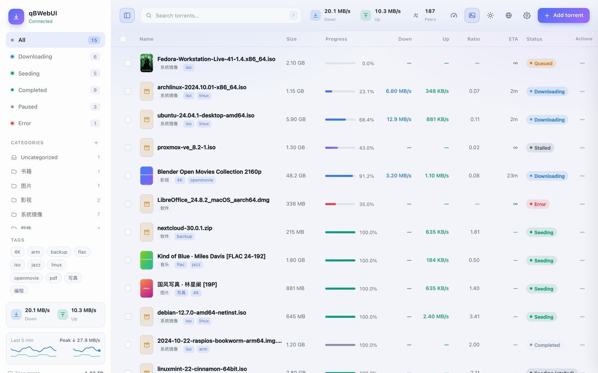
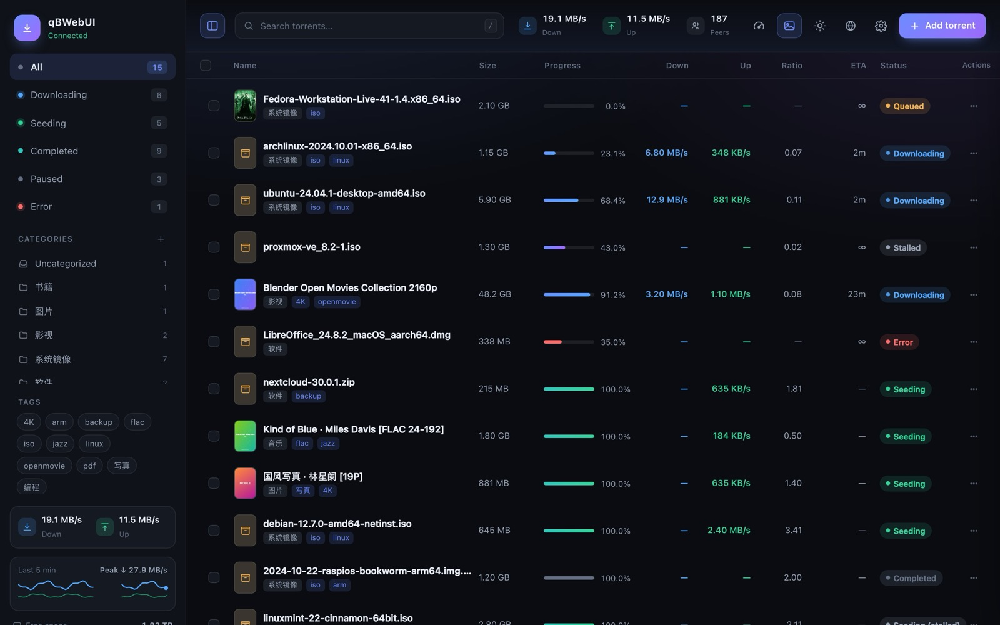
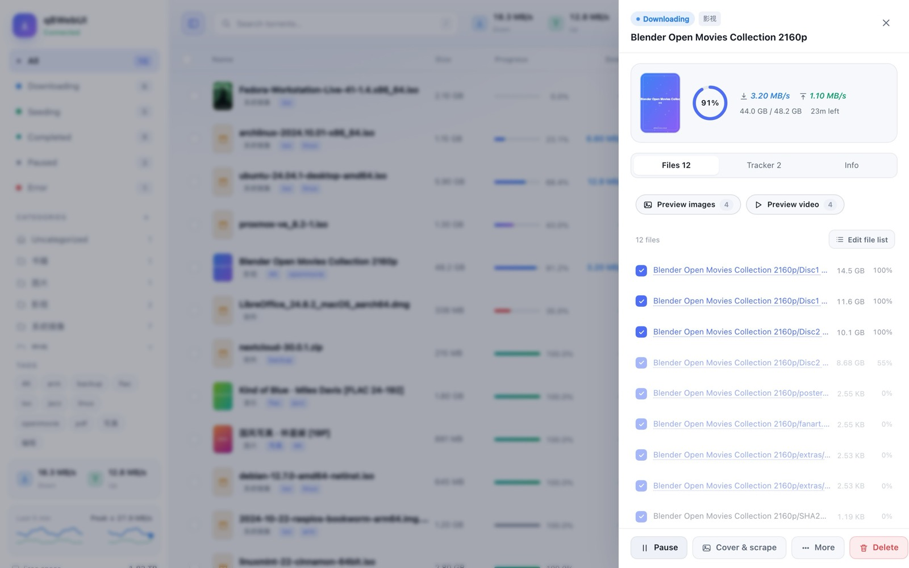
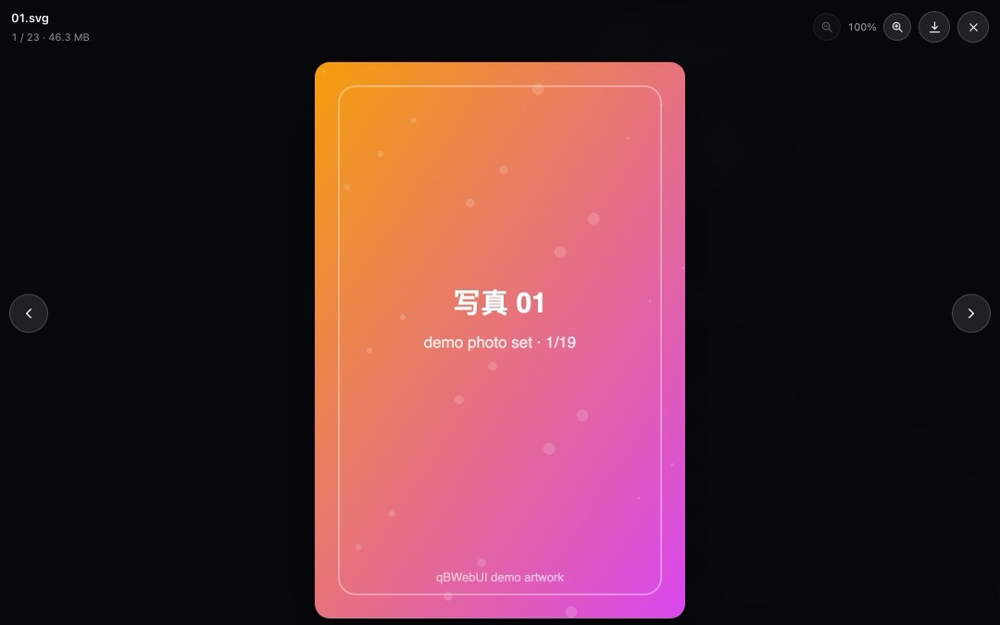
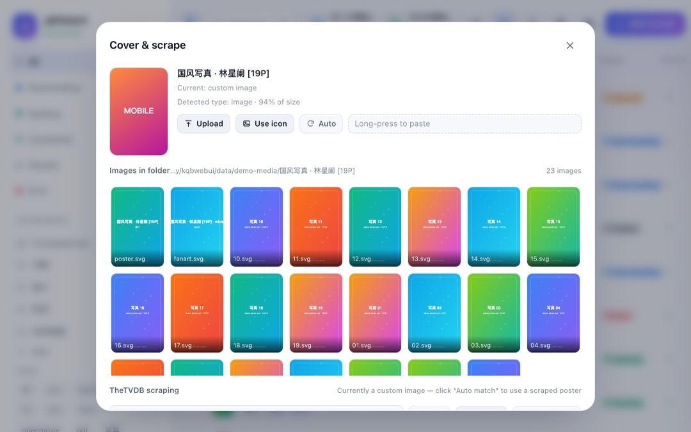
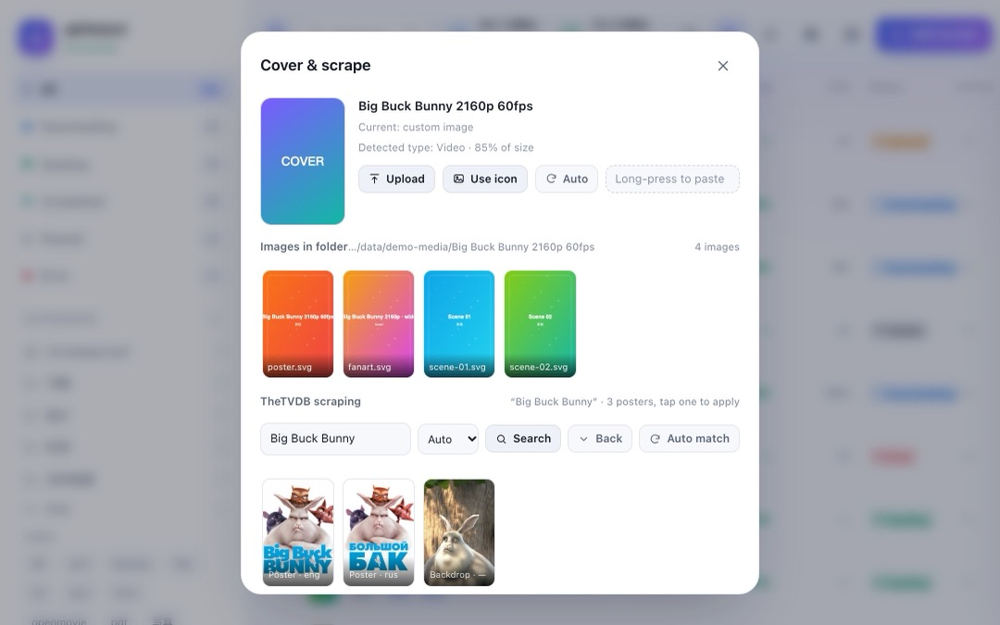
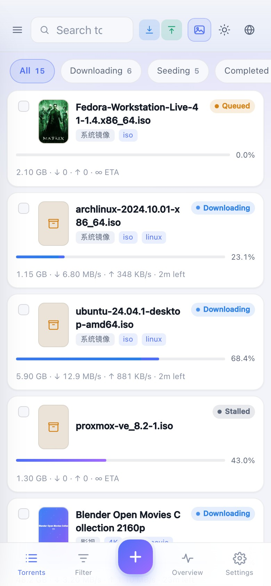
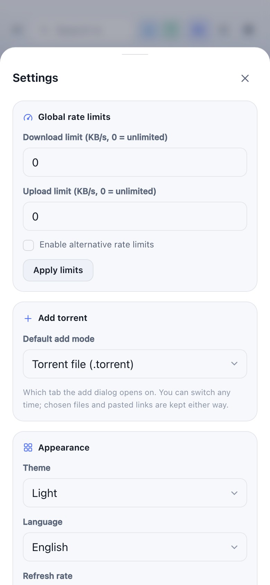

# qBWebUI

**English** | [简体中文](README.md)

A lightweight, self-hosted web console for qBittorrent. Desktop and mobile share a single responsive codebase, with **zero runtime dependencies** (Node built-ins and vanilla front-end technologies only), started with a single command.

Beyond download management, the project also completes your media artwork: it extracts images from the torrent's own folder, or scrapes posters and metadata from TheTVDB and writes them back into the torrent folder following media-library conventions, so Plex / Jellyfin / Kodi recognise them on the next scan. On mobile, "Add to Home Screen" turns it into a full-screen standalone app.




## Features

- **Torrent list**: name / size / progress / down / up / ratio / ETA / status, click a header to sort; incremental refresh every 2 seconds, stays smooth with hundreds of torrents
- **Filtering and search**: all, downloading, seeding, completed, paused, error status filters, plus category, tag and name search
- **Per-torrent actions**: pause / resume, force start, sequential download, set category, recheck, reannounce, delete (optionally with files)
- **Bulk actions**: select several, then pause, resume or delete them in one operation
- **Detail drawer**: progress ring, live speeds, average down / up speeds on the info tab (qBittorrent's `dl_speed_avg`, derived from the torrent's cumulative transfer totals and actual active time — refetched when you switch to that tab), piece and ratio details, file list, tracker status. Checkboxes in the file list are locked by default to prevent accidental changes; click "Edit file list" to skip or restore files individually. Incomplete files are rendered at reduced contrast, so completed and pending content is easy to tell apart
- **Inline preview**: images / videos / audio in the detail file list can be opened by clicking the file name. Image sets support previous / next navigation, arrow keys and horizontal swiping on mobile, plus zoom via wheel / pinch / double-tap / buttons with drag-to-pan once zoomed. Video is served with HTTP Range requests, supporting scrubbing, watching while downloading and continuous playback of multiple files. Formats the browser cannot decode (MKV / HEVC / Dolby Vision) fall back to "Download / Open in new tab"
- **Adding torrents**: magnet links, HTTP links and `.torrent` files (drag-and-drop and multi-select supported), with save path, category, tags and add-paused. The dialog opens on the "Torrent file" tab by default; the default tab can be changed to magnet in settings. Once a file is selected or a magnet is pasted, a poster is scraped automatically and applied when the torrent is added, so no separate cover step is required afterwards
- **Save path history**: the input offers a dropdown of directories — the default path first, then recently used paths, then the most common folders derived from your torrent library (with torrent counts). Keyword filtering, `↑↓` to move and `↵` to confirm
- **Cover thumbnails**: when a torrent has its own folder, an image is selected from it automatically (`poster` / `folder` / `cover` first, then `fanart` / `banner`); when no image is available it falls back to a type icon, with the type determined by the **byte weight** of the files in the folder (video / music / image / book / archive) rather than inferred from the torrent name. Manual upload, selecting another image from the folder, and pasting an image directly are also supported (`⌘/Ctrl + V` on desktop; on mobile tap "Paste" then long-press the paste box). Single-file torrents located in a shared download root are excluded from folder matching, so a poster belonging to another torrent is never picked up. Thumbnails are cached in `data/covers/` (compressed to 640px with `sips` on macOS) and the feature can be disabled entirely in settings
- **TheTVDB scraping**: identifies "title + year + season" from the feature file inside the torrent (falling back to the torrent name when unavailable) and searches [TheTVDB](https://www.thetvdb.com) for the matching series or movie, then downloads the poster. Automatic matching is available, as is manual selection from the results (list on the left, synopsis on the right) followed by choosing a specific poster. Priority: manually uploaded image > TheTVDB poster > image in the folder > type icon. Settings can enable "auto-scrape newly added video torrents", and also scrape every video torrent in the list at once (with a progress bar that can be stopped midway)
- **Written into your media library**: after a successful scrape, the poster and NFO are written into the torrent's own folder following media-library conventions — `VideoName-poster.jpg` + `VideoName.nfo` for movies, `poster.jpg` + `tvshow.nfo` for series. Plex / Jellyfin / Kodi receive the cover, original title, year and synopsis on the next scan; both files are removed if the scrape is discarded or the TheTVDB cache is cleared
- **Three list title modes**: original file name only, media title primary (original as subtitle), or the reverse — switchable according to preference
- **Settings panel**: connection address, global rate limits, default add mode, theme and refresh interval, thumbnail toggle, cover cache cleanup, TheTVDB configuration and UI update check; presented as a full-width bottom sheet on mobile
- **Global status**: up / down speed, free disk space, cumulative traffic, global rate limit and alternative speed limit
- **Speed chart**: a trend curve for the last 5 minutes of up / down traffic at the bottom of the desktop sidebar and in the mobile "Overview" tab. Sampling runs server-side (every 5 seconds, adjustable via `QBWEBUI_SAMPLE_MS`), so reloading the page or restarting the server does not restart the curve from zero; gaps are rendered as two separate segments rather than fitted with a straight line. The "peak down / peak up" figures in the detail info card come from the same sample set
- **Appearance**: dark / light / follow system; sidebar plus table on desktop, cards plus bottom navigation on mobile; installable as an app via "Add to Home Screen"
- **Collapsible desktop sidebar**: the panel icon at the far left of the top bar (highlighted while the sidebar is open) collapses the 268px sidebar and gives the width to the list; the state is stored locally. Once collapsed, status filtering moves to the row of chips with counts below the top bar, while categories and tags remain one click away in the sidebar
- **Bilingual interface**: switch between 中文 and English from the globe icon in the top bar or "Settings → Appearance → Language". The first visit follows the browser language and the choice is remembered afterwards. All strings live in `public/i18n.js`, using the Chinese original as the key, so a missing translation falls back to Chinese instead of exposing a raw key
- **Cover cache**: settings shows the number of scanned entries and the image footprint, and can clear either the scan cache (rescan folders) or the entire cover cache, including manually uploaded images

## Quick start

Requirements: Node.js ≥ 18 and a qBittorrent instance with the Web UI enabled (4.x and 5.x both work).

```bash
git clone https://github.com/kjlamuro/qbwebui.git
cd qbwebui
node server.mjs        # or npm start
```

```
Local access   http://127.0.0.1:7788
LAN access     http://192.168.x.x:7788   ← use this on mobile
```

On macOS you can also double-click `start.command` (it opens the browser automatically).

### Previewing the interface only

No qBittorrent installation is required — the built-in mock data can be used instead:

```bash
npm run demo           # http://127.0.0.1:7799
```

`tools/mock-qb.mjs` is a read-only mock qBittorrent service with 15 fictional torrents; every action returns success without writing to disk. It also generates a set of real files (including a short playable sample video and a photo set), so the image / video preview in the detail drawer can be exercised directly. The screenshots in this document were generated with it.

## Configuration

Priority: environment variables > `config.json` > defaults.

| Item | Environment variable | Default |
| --- | --- | --- |
| qBittorrent WebUI address | `QB_URL` | `http://127.0.0.1:9898` |
| Port this server listens on | `PORT` | `7788` |
| TheTVDB API key | `TVDB_API_KEY` | set in the UI (stored in `data/tvdb.json`) |
| TheTVDB subscriber PIN | `TVDB_PIN` | empty (most keys do not need it) |

```bash
QB_URL=http://192.168.1.10:9898 PORT=7788 node server.mjs
```

The qBittorrent address comes from these two sources only — **the UI provides no field for it** (the Web UI port is configured in the qBittorrent client; afterwards update `QB_URL` or `config.json` and restart this service). Omitting the field from the UI prevents confusion between "qBittorrent's WebUI address" and "the address of this page".

### TheTVDB scraping

Enter your own API key under "Settings → TheTVDB scraping" (sign in at [thetvdb.com](https://www.thetvdb.com) → Dashboard → API Keys; the free tier is sufficient for personal use). Once it is saved and the test passes, the scraping area appears in the cover dialog:

- **Automatic matching**: the **feature file name inside the torrent** is parsed first (the largest video file, skipping samples and extras), with the torrent name used only when unavailable. Noise such as `1080p` / `x264` / release group / `S01E02` is stripped, and the search is issued together with the year. When the score is high enough, the **first poster** is applied directly; when confidence is insufficient, the candidates are presented as a list for manual selection
- **Results: list on the left, synopsis on the right**: each row shows title / year / type with a small poster; selecting a row switches the right pane to that entry's **large poster and synopsis**. When one title has several versions, or series and movies are mixed together, the synopsis is a far more reliable basis for a decision than poster thumbnails. Two buttons are provided on the right: "View its posters" opens the poster grid to choose a specific image, while "Use the first one" skips that step. "Back" from the poster view returns to the previous result list from cache, without another network request
- **Why the file name inside the torrent takes priority**: torrent names are assembled by release groups (`Some.Release.2024.2160p.WEB-DL.DDP5.1.Atmos-GRP`), whereas the feature file name is usually far more regular (`The.Matrix.1999.1080p.mkv`). A `.torrent` can be parsed **before** it is added (the server reads the bencode directly, no download required); already-added torrents use qBittorrent's file list, which is available even while downloading. If the feature file name is unusable, for example `01.mkv` or `cd1.avi`, the torrent name is used instead
- **Splitting and retrying mixed Chinese / English names**: release names such as `痴迷.Obsession.2025` or `求救信号.Mayday.2026` return no results when submitted to TheTVDB as a whole string, so the segments are tried in order — "English segment → Chinese segment → whole string" — stopping at the first sufficiently similar hit. Purely English or purely Chinese names are searched once only, so no request quota is spent unnecessarily
- **Chinese titles are resolved across language codes**: Chinese on TheTVDB is not a single code — older works (such as 《The Matrix》) are filed under `zho`, works from 2020 onwards (such as 《Spider-Man: Brand New Day》) mostly only under `zhtw`, with a few under `zhcn`. Querying `zho` alone returns 404, causing the whole entry to degrade silently to an English title and English synopsis; therefore, with "Chinese" selected, `zho → zhtw → zhcn` are tried in order and the first code that yields a title is used (404 results are cached per language code as well, so the same work is not requested twice). The trade-off: newer works that only have a Traditional Chinese entry will display a Traditional title and synopsis
- **Opening the cover dialog scrapes automatically**: for a torrent that has not been scraped yet, by the time the "Cover & scrape" dialog opens, the background has already matched and applied the first poster while laying out the poster list at the same time; switching to another poster takes a single click, and no "Auto match" action is needed at any point
- **Scraping while adding a torrent**: after selecting a `.torrent` (the file is submitted to the server to extract the feature file name) or pasting a magnet link (no file list available, so it is inferred from `dn`), the add dialog matches online immediately and shows the result under "Cover thumbnail", with the remaining posters for that work laid out below using the same cards as the detail dialog (labelled "poster · language"); clicking one applies it. When the specific work cannot be determined, the dialog widens temporarily and presents **the same two-column layout as the detail dialog** — candidates on the left, and the large poster, title, type/year and synopsis of the selected entry on the right — with two buttons: "View posters" fills the grid below with all its posters, while "Use this one" takes the poster from the search result without another request. "Scrape cover" can also be used to trigger it manually; if no result is found at all, "Choose image" remains available
- **The search keyword is editable**: it defaults to the parsed title described above — `The.Matrix.1999.1080p.BluRay-GRP` appears as `The Matrix` in the box, with a line of small text beneath stating its origin: "parsed The Matrix 1999 from The.Matrix.1999.2160p.mkv in the torrent", or "recognised as … from the torrent name". The year and season stripped during parsing are still sent with the request, so cleaning up the name does not lose the year. If the parse is wrong, edit it — enter a clean title such as `Obsession` or `Sintel` and press `↵` or click "Scrape cover" to search again with the new term. An edited keyword is never overwritten by auto-scraping, consecutive clicks are not blocked by the previous request, and stale responses are discarded
- **Manual search**: the same keyword box in the cover dialog is editable, and a "series / movie" filter can be forced. Results appear as a list first; select one to read its synopsis, then choose "View its posters" to expand all posters (filterable by language) and click one to apply it
- Downloaded posters are stored in `data/covers/tvdb/` and, like the folder scan cache, are fetched online only the first time; "Clear automatic covers" removes them as well
- The API key is stored only on your machine, in `data/tvdb.json` (already listed in `.gitignore`) or in an environment variable, and is **never** bundled into the repository. TheTVDB's terms of service restrict a key to the project it was registered for (non-transferable), so this project ships no key and every user supplies their own

> TheTVDB requires attribution when its metadata is displayed; the cover dialog and the settings panel already include a "Metadata provided by TheTVDB" link. Posters and metadata remain the property of their respective rights holders; TheTVDB does not endorse any licensing of the images, and they are intended for personal local use only.

> Common configuration pitfall: `Connection → Listening port` in qBittorrent's settings (for example 40459) is the BitTorrent port, **not** the Web UI port. What belongs in `QB_URL` / `config.json` is `Web UI → Port` (for example 9898).

## Use on mobile

1. Connect the mobile device and the host to the same Wi-Fi network
2. Open `http://<host LAN IP>:7788` (the terminal prints the local and LAN addresses when the server starts)
3. In iOS Safari choose "Share → Add to Home Screen", or in Android Chrome choose "Add to Home Screen"; it then runs full-screen as a standalone app (the `manifest` is already configured)

If a login dialog appears on first open, enter the qBittorrent username and password; enabling "Remember this device" signs in automatically on that device afterwards. The LAN subnet can also be added to qBittorrent's "Web UI → Bypass authentication for clients on localhost" list (for example `192.168.1.0/24`).

### iOS / PWA notes

- After being added to the home screen it runs as a standalone app: the status bar and bottom gesture area respect `safe-area` insets, and light / dark follow the system
- **The remembered login is stored server-side** (the `remember` field in `config.json`, already listed in `.gitignore`): iOS WebKit clears a web page's localStorage after 7 days without interaction, so keeping the credentials server-side prevents them from being lost. The session is renewed by the server and the app opens already signed in
- A Service Worker is built in: static shell caching combined with background updates (stale-while-revalidate), so a second open is nearly instant and the interface skeleton still renders on a poor or absent network. `/api/*` responses are always fetched live and never cached. After a new version is deployed, the next open refreshes once automatically
- Input fields are 16px on mobile so iOS does not zoom in on focus; long-press selection and double-tap zoom are disabled in the list
- Every bottom sheet on mobile (detail / action menu / overview / settings, plus the add and cover dialogs) can be dismissed by dragging down: hold the drag handle or the title bar and pull down, and the same applies once the content is scrolled to the top and the gesture continues. Beyond 88px of travel, or on a quick flick, it closes; below the threshold it springs back, as it does when a second finger touches down or a system gesture interrupts. Pushing upwards still scrolls normally. The login dialog is excluded from the gesture, and dragging down a confirmation dialog is equivalent to "Cancel"

## Keyboard shortcuts (desktop)

| Key | Action |
| --- | --- |
| `/` or `⌘/Ctrl + F` | Focus the search box |
| `a` | Add torrent |
| `Space` | Pause / resume (applies to the selection when rows are selected) |
| `Esc` | Close preview / dialog / detail, clear selection |
| `←` `→` | Previous / next image in the preview |
| `+` / `-` / `0` | Zoom in / out / reset to 100% in the preview |

## Screenshots

| Dark theme | Detail drawer |
| --- | --- |
|  |  |

Images and videos in the file list can be opened by clicking the file name; image sets support paging and zooming, and videos support scrubbing and continuous playback of multiple files:



To change a cover, click the thumbnail in the list or "Cover & scrape" at the bottom of the detail drawer (the same entry is in the action menu), then upload an image, select a different one from the torrent folder, or fall back to the type icon. **Besides the file picker, images can also be pasted directly** — output from a screenshot tool (`⌘⇧4`), "Copy image" from a web page, or an image file copied in the file manager all take effect immediately with `⌘/Ctrl + V` in the dialog. When pasting while adding a torrent, the image is previewed first and written to disk once the torrent has been added. Keyboard pasting is unavailable on mobile, so "Paste" opens a paste box where a long press followed by "Paste" completes the action (the system does not allow a web page to read the clipboard directly, so this is the only available path; Android Chrome, when permitted, does it in one step):



With TheTVDB configured, the same dialog gains a scraping area supporting automatic matching, title editing for a new search, and selection of a specific poster:



<p align="center">
  
  
</p>

## Security notes

- The server listens on `0.0.0.0` by default, so **any other device on the same LAN can open this page**. Do not expose it to the public internet; for remote access use a VPN or an authenticating reverse proxy.
- "Remember this device" stores the qBittorrent username and password in plain text in the browser's `localStorage`; do not enable it on a shared device.
- The proxy holds qBittorrent's SID in memory only and never writes it to disk, so restarting the service requires signing in again.
- This project has no user system of its own; authentication is entirely qBittorrent's responsibility.
- The cover cache is written to `data/covers/`, and its index contains **absolute local disk paths**; that directory is therefore listed in `.gitignore` alongside `config.json` and never enters the repository.

## Why a local Node server is required

A browser connecting to the qBittorrent Web UI directly is blocked by CORS, and the session credential (SID) is an HttpOnly cookie that the front-end cannot read. `server.mjs` therefore has exactly two responsibilities:

1. Serve the static pages under `public/`
2. Reverse-proxy `/api/v2/*` to qBittorrent while **holding the SID server-side**

The front-end consequently communicates only with its own origin: no CORS issues and no build step.

## Project layout

```
server.mjs              static hosting + API reverse proxy (SID session)
start.command           double-click launcher for macOS
public/
  index.html            page skeleton, SVG icon sprite
  styles.css            design system, light/dark themes, responsive layout
  i18n.js               zh/en dictionaries + DOM binding + language switch
  app.js                polling, rendering and interaction logic
  manifest.webmanifest  PWA manifest
  sw.js                 Service Worker (static shell cache + background update)
  icon*.svg/png         icon assets
lib/
  covers.mjs            cover cache, candidate image scanning, cover endpoints
  tvdb.mjs              TheTVDB v4 client (login / search / poster download / name parsing)
tools/
  mock-qb.mjs           mock qBittorrent (for demos and development)
  demo.mjs              one command to bring up the demo environment
  shots.mjs             generates the screenshots in docs/ (headless Chrome + CDP, zero deps)
  i18n-check.mjs        verifies that every UI string has an English translation
  assets/demo.mp4       short sample video (detail-page video preview / continuous playback)
docs/                   documentation screenshots (Chinese UI)
docs/en/                documentation screenshots (English UI)
```

## Implementation notes

- Every 2 seconds it fetches `/torrents/info` and `/sync/maindata?rid=` concurrently; the latter is incremental and `server_state` **carries only changed fields**, so the response must be merged rather than applied wholesale, otherwise "free space" is reset to 0
- The list uses a keyed DOM diff: only changed text and progress values are updated, and reordering is handled with CSS `order`
- Pausing in qBittorrent takes effect **asynchronously** (1–2 seconds later), so the front-end applies an optimistic update and keeps a 2.5 second window to prevent status flicker
- Both WebAPI 5.x `stop/start` and the older `pause/resume` are supported, with automatic fallback on failure
- The save-path dropdown is positioned dynamically with `position: fixed` so the dialog's scroll container cannot clip it, and it opens upwards when the space below is insufficient
- Table column widths are calibrated across four `--row-grid` breakpoints so the columns fit **even at the narrowest width within that breakpoint** (usable width ≈ viewport − 268px); otherwise the boundaries at 901/1041/1181/1281 overflow and the rightmost action column is clipped
- The action menu is a single component with two presentations: a bottom sheet at ≤900px and a centred overlay above 900px
- **Drag-to-dismiss gesture** (the "drawer drag-to-close" module in `public/app.js`): the top 64px of the card is taken over directly rather than competing with the inner scroller, and once the content is scrolled to the top a continued downward drag is taken over as well, while an upward push is passed through to native scrolling. Displacement is written once per frame (`touchmove` can fire several times within a frame, more densely on 120Hz devices) and velocity is derived from the last 90ms of movement, so press-then-flick is detected correctly. The scrim is split into its own layer where only `opacity` changes (a pure compositing operation), and its `transition` and the full-screen `backdrop-filter` are disabled during the drag; otherwise every write would restart a transition and recompute a Gaussian blur. Any mid-gesture abandonment (a second finger touching down, a system `touchcancel`) follows the same cleanup path, springing back and clearing inline styles; `resetDrawer` also runs when the drawer opens or closes, so a half-transparent scrim can never be left behind
- Covers are scanned only when a torrent "has its own folder" (`content_path` is a directory and differs from `save_path`); single-file torrents are skipped so a poster belonging to another torrent in a shared download directory is never picked up
- **Type icons are not inferred from the name**: the backend scans the torrent folder (or requests the file list from qBittorrent) and determines the primary type by the **byte weight** of each file class (video / music / image / book / archive image). In a TV season, a single poster never outweighs a 20GB feature file; the front-end uses the category and torrent name only as a temporary placeholder until the result arrives
- Folder scan results are cached for 60 seconds and images are normalised into `data/covers/` (original → 640px thumbnail), so an external drive is not traversed repeatedly for each row's thumbnail
- Caching has two layers: **memory → `scan.json` → actual disk scan**. Torrents still downloading are rescanned after 60 seconds, completed ones after 6 hours. `scan.json` is written with a merge, so it still hits after a restart and the external drive is not traversed again the next morning. Settings provides a cache overview plus one-click clearing of either the scan results or the entire cover cache
- Type results are cached by **source**, **independently of folder scanning**: results derived from the torrent's file list remain valid permanently (metadata does not change), results from a folder scan are valid for 30 minutes (6 hours once completed), and pure name guesses for only 60 seconds. A cached result therefore never implies a wait — retrieving a type does not trigger a folder scan as a side effect
- **The first type is written while the torrent is being added**: qBittorrent has the file list as soon as it accepts the torrent (metadata does not depend on download progress), so a new torrent enters the list with the correct icon instead of waiting for a folder scan; only magnets that have not yet retrieved metadata receive a temporary guess based on the name or category
- Detail-page preview reads `save_path` directly: qBittorrent's `files[].name` is a full relative path **rooted at the save directory** and already includes the torrent folder name for multi-file torrents, so joining it to `content_path` again would produce `folder/folder/file`. Files still downloading additionally try the temporary directory and the `.part` / `.!qB` suffixes; video is served with 206 Partial Content and HTTP Range, streaming the file instead of reading it entirely into memory or into the browser cache first, which is what makes scrubbing and watch-while-downloading possible
- **TheTVDB scraping runs server-side**: the login token (valid for one month) and the search / poster-list results are cached on disk, so the same work is never requested twice; translations are cached per **language code** (`zho` / `zhtw` / `zhcn` each record their own 404), and `TR_SCHEME` invalidates the entire search cache when the translation strategy changes, preventing stale English names from matching indefinitely. Automatic matching uses a scoring model (exact normalised name +100, year ±1, series/movie type bonus); below the threshold the choice is handed to the user rather than forced, which avoids matching an unrelated work that happens to share the title. Mixed Chinese / English release names are split into several query terms tried one after another, stopping above 70 points — this was the root cause of "automatic matching finds nothing while a manual English search succeeds", since the whole string `痴迷 Obsession` returns zero results on TheTVDB
- **Thumbnails are requested on demand**: the type endpoint also returns a flag indicating whether the torrent has a cover (read from the cache only, without triggering a scan), and the front-end requests images only for rows flagged as having one. Without this mechanism, a dozen visible rows would each trigger a 404, plus a wasted `stat` call on an external drive
- **Speed sampling runs permanently server-side** (`lib/speedlog.mjs`): recording must continue while the browser is closed, otherwise the curve always starts at the moment the page was opened. Sampling uses the incremental `/sync/maindata` endpoint, so hundreds of torrents return only the changed rows instead of pulling hundreds of kilobytes from `/torrents/info` every 5 seconds (it degrades to a one-minute fallback only when the incremental call returns no torrents at all). Two hours of samples are kept in memory and written to `speed-history.json` every 60 seconds plus once on exit, so the history continues across restarts. `/__speed?window=` serves the curve and `/__speed/peak?hash=` the per-torrent peak. The peak is defined as "the maximum observed by the 5-second samples" — the true instantaneous peak can only be higher, and the interface states this explicitly
- **An iOS standalone PWA has a layout viewport shorter than the screen**: launched from a home screen icon, the top of the viewport sits directly below the status bar, so neither `100vh` nor `fixed bottom: 0` reaches the actual bottom of the screen (the difference equals the top safe-area height). Bottom-anchored elements therefore receive a `--icb-deficit` offset derived from `env(safe-area-inset-top)`, applied only in standalone mode when a deficit is actually measured. In addition, `apple-mobile-web-app-status-bar-style` should not be used; letting the manifest's `standalone` take the modern path avoids an entire class of status bar geometry problems
- **A dialog body is a scroll container, not a compressible box**: `.modal-body` lays out cards with `flex-direction: column`, and children default to `flex-shrink: 1`, so a short window compresses the content first (cutting posters in the cover grid in half) instead of producing a scrollbar — hence the explicit `flex: 0 0 auto`
- **The Chinese original serves as the i18n key**: `t('下载中')` looks the string up in the English dictionary and falls back to the key itself, so an untranslated string degrades to Chinese rather than exposing `some.dotted.key`; static labels are bound declaratively through `data-i18n` / `data-i18n-text` / `data-i18n-html` / `data-i18n-title` / `data-i18n-placeholder` / `data-i18n-aria`. A short inline script in `<head>` sets `html[data-lang]` before the first paint and hides the body until `app.js` has applied the dictionaries, so English users never see a flash of Chinese; a 2-second timeout guarantees that a script failure does not leave a blank page. Switching language re-renders in place and invalidates the `_v` / `_sig` render caches rather than reloading the page

## Development

```bash
npm run demo         # run the interface on mock data; no real qBittorrent needed for front-end work
npm run shots        # regenerate the screenshots in docs/ (requires Chrome / Chromium locally)
npm run shots:en     # regenerate the English screenshots in docs/en/
npm run check        # syntax check + i18n coverage check
npm run i18n         # only verify that every UI string has an English translation
```

There is no bundling step for the front-end: edit `public/` and refresh. The screenshot script is implemented on the Chrome DevTools Protocol; it starts a temporary headless instance, executes a scripted sequence of interactions and captures the result, so interface states such as "detail drawer open" or "poster search performed" are reproducible.

## Known limitations

- Single instance, single user: no multi-user support or permission system; authentication is delegated to qBittorrent
- RSS, search plugins, rate-limit scheduling and other niche panels from qBittorrent's native interface are not included
- Sub-path deployment (for example `https://example.com/qb/`) is not supported yet

## Trademarks

The `qBittorrent` name and its official marks belong to the qBittorrent project. The icon of this project is drawn independently: it borrows only the brand blue (`#2F67BA`) as a colour cue, and the `qb` letters are constructed from rounded geometric strokes. No official SVG asset is used.

There are two reasons for not reusing the official mark. First, the official logo file `src/icons/skin/qbittorrent-tray.svg` is released under the LGPL while this project is MIT, so bundling it would create a licence conflict. Second, using another product's mark as your own application icon is trademark use and implies endorsement. Should the qBittorrent project consider this icon confusing, it can be replaced at any time.

## License

[MIT](LICENSE). Not affiliated with qBittorrent; this is a third-party client.
