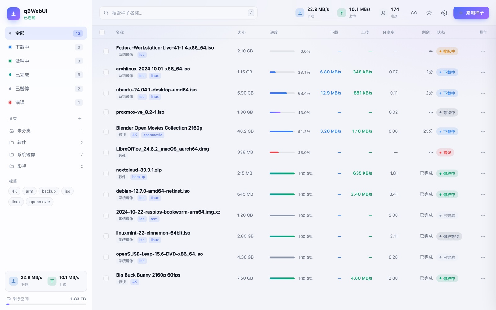
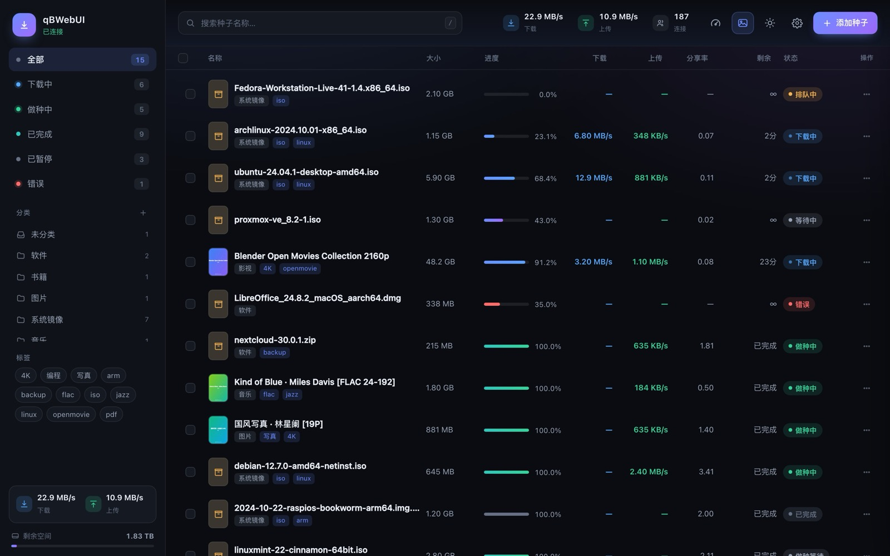
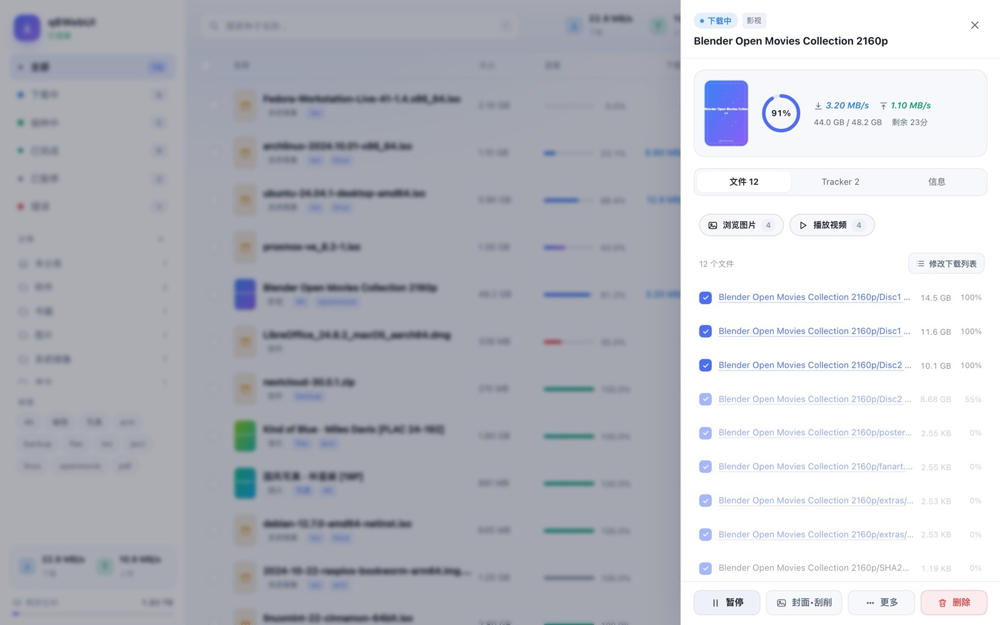
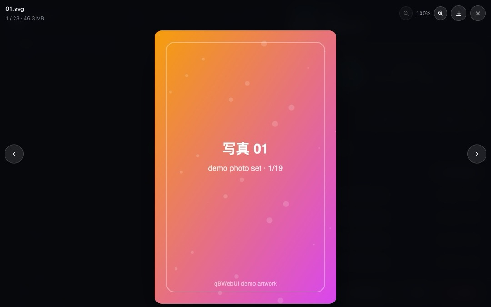
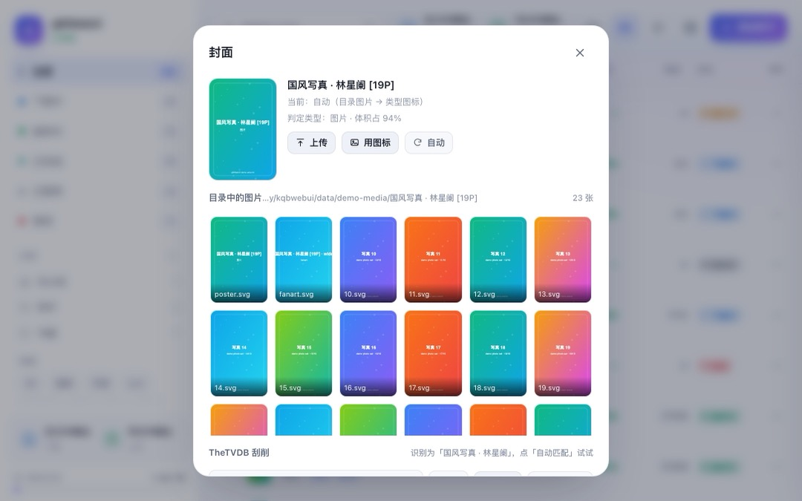
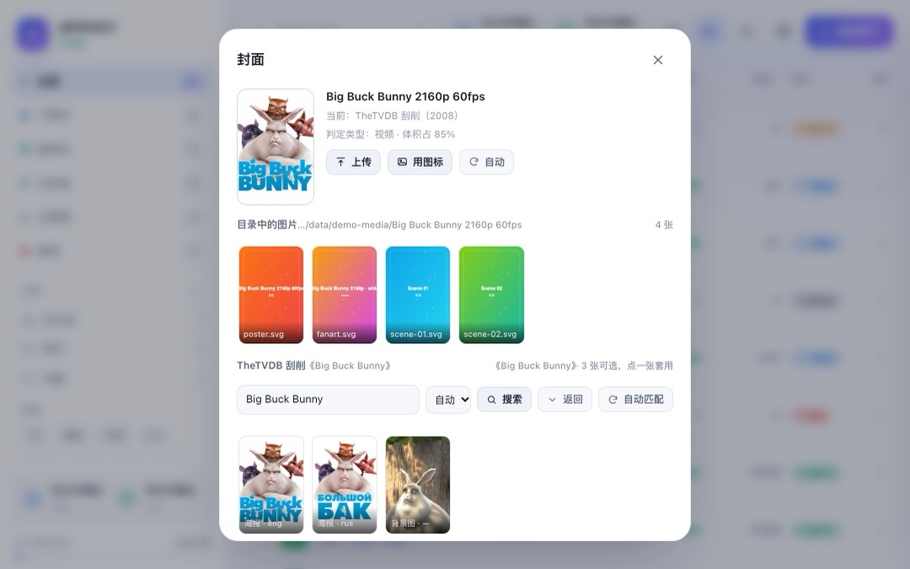
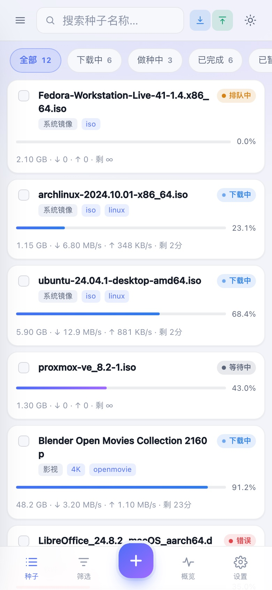
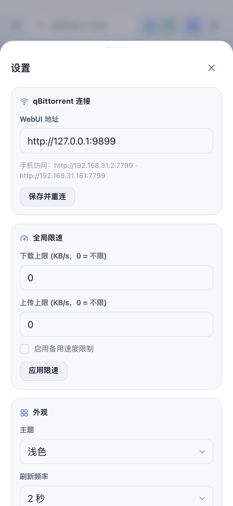

# qBWebUI

轻量、好看的 qBittorrent 网页控制台。桌面与手机同一套代码自适应，**零运行时依赖**（只用 Node 内置模块 + 原生前端），一条命令启动。

除了下载管理，它顺手把封面补齐：从种子自己的目录里找图，或者用 TheTVDB 刮削海报和元数据，刮完直接按媒体库约定写进种子目录，Plex / Jellyfin / Kodi 扫一下就认。手机上「添加到主屏幕」就是一个能全屏跑的 App。




## 特性

- **列表**：名称 / 大小 / 进度 / 下载 / 上传 / 分享率 / 剩余时间 / 状态，点表头排序；每 2 秒增量刷新，几百个种子也不卡
- **筛选**：全部、下载中、做种中、已完成、已暂停、错误；分类、标签、名称搜索
- **单条操作**：暂停 / 继续、强制开始、顺序下载、设置分类、重新校验、重新通告 Tracker、删除（可选删文件）
- **批量操作**：多选后统一暂停 / 恢复 / 删除
- **详情抽屉**：进度环、实时速度、分块与分享率、文件列表、Tracker 状态。文件列表里的勾选框默认锁着（防误点），点「修改下载列表」才能逐个跳过 / 恢复；没下完的文件整行显示得更淡，一眼分得清哪些已经有了
- **在线预览**：详情页文件列表里的图片 / 视频 / 音频点名字就能看；图片集支持上一张 / 下一张、方向键和手机左右滑动，还能用滚轮 / 双指 / 双击 / 按钮缩放，放大后拖动查看细节；视频按 HTTP Range 分片读取，支持拖进度条、边下边看和多文件连播；MKV / HEVC / 杜比视界等浏览器放不了的编码会给出「下载 / 新标签打开」兜底
- **添加种子**：magnet / 链接 / `.torrent` 文件（支持拖拽、多选），可指定保存路径、分类、标签、暂停添加；默认停在「种子文件」页，想默认用 magnet 可在设置里改
- **保存路径历史**：输入框下拉切换目录——默认路径置顶，其次是最近用过的，最后是从种子库统计出的常用目录（带种子数）；支持关键词过滤、`↑↓` 选择、`↵` 确认
- **封面缩略图**：种子有自己目录时，自动从里面挑图片（`poster` / `folder` / `cover` 优先，`fanart` / `banner` 次之），没有就回退到类型图标——类型按目录内文件**体积权重**判定（视频 / 音乐 / 图片 / 书籍 / 压缩包），不是靠种子名瞎猜；也可以手动上传、或直接从目录里选一张。单文件种子躺在共享下载根目录时不做目录匹配，以免错拿别的种子的海报。缩略图缓存在 `data/covers/`（macOS 上顺带用 `sips` 压到 640px），可在设置里一键关掉
- **TheTVDB 刮削**：按种子名自动识别「片名 + 年份 + 季」，去 [TheTVDB](https://www.thetvdb.com) 搜索匹配的剧集 / 电影并下载海报；可以自动匹配，也可以在候选里手挑、再选具体哪一张海报。优先级：上传的图片 > TVDB 海报 > 目录里的图 > 类型图标。设置里可开「新加入的影视种子自动刮削」，也能一键给列表里所有影视种子刮一遍（带进度条，可中途停）
- **写进媒体库**：刮削成功后，海报和 NFO 按媒体库约定落到种子自己的目录——电影是 `视频名-poster.jpg` + `视频名.nfo`，剧集是 `poster.jpg` + `tvshow.nfo`。Plex / Jellyfin / Kodi 扫库就能拿到封面、原名、年份、简介；放弃刮削或清空 TVDB 缓存时会一并删掉
- **列表标题三档**：只显示原始文件名、媒体名为主（原名为副）、原名为副（媒体名为主），随你偏好切
- **设置面板**：连接地址、全局限速、添加种子默认方式、主题与刷新频率、缩略图开关、封面缓存清理、TheTVDB 刮削配置、检查界面更新；手机上是全宽底部抽屉
- **全局**：上下行速度、剩余空间、累计流量、全局限速、备用速度限制
- **外观**：深色 / 浅色 / 跟随系统；桌面端侧边栏 + 表格，移动端卡片 + 底部导航；可「添加到主屏幕」当 App 用
- **封面缓存**：设置里显示扫描条目数与图片占用，可清空扫描缓存（重新扫目录）或全部封面缓存（连上传的一起清）

## 快速开始

需要 Node.js ≥ 18，以及一个开着 Web UI 的 qBittorrent（4.x / 5.x 都可以）。

```bash
git clone https://github.com/kjlamuro/qbwebui.git
cd qbwebui
node server.mjs        # 或 npm start
```

```
本机   http://127.0.0.1:7788
局域网 http://192.168.x.x:7788   ← 手机用这个
```

macOS 也可以直接双击 `start.command`（会自动打开浏览器）。

### 只想先看看界面？

不需要装 qBittorrent，用内置的假数据跑一遍：

```bash
npm run demo           # http://127.0.0.1:7799
```

`tools/mock-qb.mjs` 是一个只读的假 qBittorrent，15 个虚构种子，任何操作都只返回成功、不落盘。它会顺手生成一套真实文件（含一段可以播放的示例视频和一组写真），详情页的图片 / 视频预览可以直接试。README 里的截图就是用它生成的。

## 配置

优先级：环境变量 > `config.json` > 默认值。

| 项 | 环境变量 | 默认 |
| --- | --- | --- |
| qBittorrent WebUI 地址 | `QB_URL` | `http://127.0.0.1:9898` |
| 本服务监听端口 | `PORT` | `7788` |
| TheTVDB API Key | `TVDB_API_KEY` | 界面里填（存 `data/tvdb.json`） |
| TheTVDB 订阅者 PIN | `TVDB_PIN` | 空（多数 key 不需要） |

```bash
QB_URL=http://192.168.1.10:9898 PORT=7788 node server.mjs
```

也可以在界面「设置 → qBittorrent 连接」里改，会写入 `config.json` 并立即生效（该文件已在 `.gitignore` 里）。

### TheTVDB 刮削

在「设置 → TheTVDB 刮削」里填上自己的 API Key（[thetvdb.com](https://www.thetvdb.com) 登录 → Dashboard → API Keys，免费档够个人用），保存并测试通过后，封面弹窗里就会出现刮削区：

- **自动匹配**：种子名先被解析成片名（剥掉 `1080p` / `x264` / 制作组 / `S01E02` 这些噪音），再带年份去搜索，分数够高就直接套用它的**第一张海报**；没把握就把候选摆出来让你挑
- **中英混排的名字会自动拆开重试**：`痴迷.Obsession.2025`、`求救信号.Mayday.2026` 这种发布名整串丢给 TVDB 是一条都搜不到的，所以会按「英文段 → 中文段 → 整串」逐个试，命中一个够像的就停；纯英文 / 纯中文的名字只搜一次，不为省事多烧额度
- **打开封面弹窗就自动刮**：还没刮过的种子，打开「封面•刮削」时后台已经匹配并套好第一张海报，海报列表同时铺开——想换一张点一下就行，全程不用点「自动匹配」
- **手动搜索**：搜索框里的片名可以改，也能强制按「剧集 / 电影」过滤；点候选展开它全部海报（可按语言过滤），点海报即套用
- 下载下来的海报存在 `data/covers/tvdb/`，与目录扫描缓存一样只在第一次联网；「清空自动封面」会连它一起清掉
- API Key 只保存在本机 `data/tvdb.json`（已在 `.gitignore` 里）或环境变量里，**不会**被打包进仓库——TheTVDB 的服务条款把 key 限定为「申请时登记的那个项目」使用（non-transferable），所以本项目不内置任何密钥，每位使用者填自己的

> TheTVDB 要求展示其元数据时注明来源，封面弹窗与设置面板里已带 "Metadata provided by TheTVDB" 链接。海报与元数据的版权归各自权利人，TVDB 不为图片授权背书，请仅作个人本地用途。

> 常见坑：qBittorrent 设置里的 `连接 → 监听端口`（例如 40459）是 BT 端口，**不是** WebUI 端口。要填的是 `Web UI → 端口`（例如 9898）。

## 手机上用

1. 手机和电脑连同一个 Wi-Fi
2. 打开 `http://<电脑局域网 IP>:7788`
3. iOS Safari「分享 → 添加到主屏幕」，Android Chrome「添加到主屏幕」，即可全屏独立运行（已配 `manifest`）

首次打开若弹登录框，输入 qBittorrent 的用户名密码；勾选「记住这台设备」后本机自动登录。也可以在 qBittorrent 里把内网段加进「Web UI → 免验证白名单」（如 `192.168.1.0/24`）。

### iOS / PWA 说明

- 「添加到主屏幕」后即以独立 App 运行：状态栏与底部手势条已按 `safe-area` 适配，深浅色跟随系统
- **记住登录用的是服务端**（`config.json` 里的 `remember` 字段，已在 `.gitignore`）：iOS 的 WebKit 会在 7 天不交互后清掉网页的 localStorage，密码存在服务端就不会丢，会话由服务端自动续，打开即是登录态
- 内置 Service Worker：静态壳缓存 + 后台更新（stale-while-revalidate），二次打开秒开，弱网/离线也能看到界面骨架；`/api/*` 数据一律直连不缓存。部署新版本后，下次打开会自动刷新一次
- 输入框在移动端统一 16px，避免 iOS 聚焦时页面自动放大；列表禁用了长按选中与双击缩放

## 快捷键（桌面）

| 键 | 作用 |
| --- | --- |
| `/` 或 `⌘/Ctrl + F` | 聚焦搜索 |
| `a` | 添加种子 |
| `空格` | 暂停 / 恢复（有选中则批量） |
| `Esc` | 关闭预览 / 弹窗 / 详情，取消选择 |
| `←` `→` | 预览图片时切换上一张 / 下一张 |
| `+` / `-` / `0` | 预览图片时放大 / 缩小 / 恢复 100% |

## 界面

| 深色主题 | 详情抽屉 |
| --- | --- |
|  |  |

文件列表里的图片 / 视频点名字就能看；图片集可以前后翻页、缩放查看细节，视频支持拖进度条和多文件连播：



封面不满意？点列表里的缩略图，或详情页底部的「封面•刮削」（操作菜单里同一项也能进），可以直接上传、从种子目录里另挑一张、或退回类型图标：



配好 TheTVDB 之后，同一个弹窗里会多出刮削区：自动匹配、改片名搜索、挑具体哪张海报：



<p align="center">
  
  
</p>

## 安全说明

- 服务默认监听 `0.0.0.0`，**同一局域网内的人都能打开这个页面**。不要把它暴露到公网；需要远程访问请走 VPN 或带鉴权的反向代理。
- 「记住这台设备」会把 qBittorrent 账号密码以明文存在浏览器 `localStorage` 里，共用电脑请勿勾选。
- 代理只在内存里持有 qBittorrent 的 SID，不写磁盘；重启服务需要重新登录。
- 本项目不包含任何用户系统，鉴权完全交给 qBittorrent 自己。
- 封面缓存写在 `data/covers/`，其索引里含**本机磁盘绝对路径**，因此该目录和 `config.json` 一样已在 `.gitignore` 中，不会进入版本库。

## 为什么要有一个本地 Node 服务

浏览器直连 qBittorrent WebUI 会被 CORS 拦掉，登录凭证（SID）又是 HttpOnly Cookie，前端拿不到。所以 `server.mjs` 只做两件事：

1. 托管 `public/` 下的静态页面
2. 把 `/api/v2/*` 反向代理到 qBittorrent，**在服务端**保管 SID

前端因此只和同源地址打交道，没有跨域问题，也不需要任何构建步骤。

## 目录

```
server.mjs              静态托管 + API 反向代理（SID 会话）
start.command           macOS 双击启动
public/
  index.html            页面骨架、SVG 图标集
  styles.css            设计系统、深浅色、响应式布局
  app.js                轮询、渲染、交互逻辑
  manifest.webmanifest  PWA 清单
  sw.js                 Service Worker（静态壳缓存 + 后台更新）
  icon*.svg/png         图标
lib/
  covers.mjs            封面缓存、候选图扫描、封面接口
  tvdb.mjs              TheTVDB v4 客户端（登录 / 搜索 / 海报下载 / 种子名解析）
tools/
  mock-qb.mjs           假 qBittorrent（演示 / 开发用）
  demo.mjs              一条命令拉起演示环境
  shots.mjs             生成 docs/ 里的截图（无头 Chrome + CDP，零依赖）
  assets/demo.mp4       演示用的小视频（详情页视频预览 / 连播）
docs/                   README 截图
```

## 实现要点

- 每 2 秒并发拉 `/torrents/info` 和 `/sync/maindata?rid=`；后者是增量，`server_state` **只带变化字段**，必须合并而不是覆盖，否则「剩余空间」会变成 0
- 列表用 keyed DOM diff：只更新变化的文本 / 进度，靠 CSS `order` 重排
- qBittorrent 的暂停是**异步**的（1~2 秒后才生效），前端先乐观更新并保留 2.5 秒窗口，避免状态回弹闪烁
- 兼容 WebAPI 5.x 的 `stop/start` 与旧版的 `pause/resume`，失败时自动切换
- 保存路径下拉用 `position: fixed` 动态定位，不会被弹窗的滚动容器裁切；下方空间不足时向上展开
- 表格列宽分 4 档 `--row-grid` 分别校准到**该断点最窄时也放得下**（可用宽 ≈ 视口宽 − 268px），否则 901/1041/1181/1281 这些交界处会溢出、最右侧操作列被裁掉
- 操作菜单同一个组件两套形态：≤900px 底部抽屉，>900px 居中浮层
- 封面只在种子「有自己的目录」时才扫（`content_path` 是目录且不等于 `save_path`）；单文件种子直接跳过，避免把共享下载目录里别的种子的海报拿来用
- **类型图标不是靠猜名字**：后端扫一遍种子目录（或向 qBittorrent 要文件清单），按各类文件的**体积权重**判定主类型（视频 / 音乐 / 图片 / 书籍 / 压缩包镜像），一部剧里 1 张海报永远压不过 20GB 正片；前端只在结果没到之前用分类、种子名临时顶着
- 目录扫描结果缓存 60 秒，图片统一落到 `data/covers/`（原图 → 640px 缩略图），外置盘不会因为每行缩略图被反复遍历
- 缓存分两层：**内存 → `scan.json` → 真扫盘**。下载中的种子 60 秒重扫，已完成的种子 6 小时；`scan.json` 落盘合并写入，服务重启后仍命中，第二天开机也不会再遍历外置盘。设置里可以看到缓存概况，并可一键清空扫描结果或全部封面缓存
- 类型结果按**来源**分级缓存，并且**独立于目录扫描**：来自种子文件清单的永久有效（元数据不会变），来自目录扫描的 30 分钟（已完成 6 小时），纯靠名字猜的只信 60 秒。所以「有缓存」不该再有任何等待——取类型时不会再顺带去扫一遍目录
- **添加种子时就写第一次类型**：qBittorrent 收下种子后立刻就有文件清单（元数据不依赖下载进度），所以新种子一进列表就是对的图标，不用等目录扫描；只有磁力还没拿到元数据时才先用名字/分类猜一个顶着
- 详情页预览直接读 `save_path`：qBittorrent 的 `files[].name` 是**以保存目录为根**的完整相对路径，多文件种子已经带上了种子目录名，不能再拿 `content_path` 当基准拼一次，否则会变成 `目录/目录/文件`。下载中的文件会额外尝试临时目录和 `.part` / `.!qB` 后缀；视频用 206 Partial Content + HTTP Range 边读边播，不会把整段文件读进内存或先落到浏览器缓存，拖进度条、边下边看都靠它
- **TheTVDB 刮削在服务端完成**：登录 token（有效期 1 个月）和搜索 / 海报列表结果都落盘缓存，同一部作品不会重复请求；自动匹配带打分（名字归一化完全相等 +100、年份 ±1、剧集/电影类型加成），分数低于阈值宁可交给人挑也不硬套，避免「匹配到同名的烂片」。中英混排的发布名会拆成多个查询词逐个试，命中 70 分以上就停手——这是「自动匹配搜不到、手动只打英文却能搜到」的根因，整串 `痴迷 Obsession` 在 TVDB 上是零结果
- **缩略图按需请求**：后端在类型接口里顺带回一个「这个种子有没有封面」的标记（只读缓存、不触发扫盘），前端只对标记为「有」的行发图片请求。没有这一层的话，一屏十几行会各撞一次 404，外置盘还要白 stat 一遍
- **iOS 独立 PWA 的布局视口比屏幕矮**：从主屏图标进入时，视口顶部贴着状态栏下沿，`100vh` 和 `fixed bottom: 0` 都到不了屏幕真正的底部（相差的正好是顶部安全区那段）。所以贴底元素按 `env(safe-area-inset-top)` 推一段 `--icb-deficit` 补偿，这个补偿只在「独立模式 + 实测有缺口」时生效。另外别用 `apple-mobile-web-app-status-bar-style`，交给 manifest 的 `standalone` 走现代通道，省掉一整套状态栏几何问题
- **弹窗正文是滚动容器，不是可压缩的盒子**：`.modal-body` 用 `flex-direction: column` 排卡片，子项默认 `flex-shrink: 1`，窗口一矮就会先把内容压扁（封面网格里的海报被裁掉半截）而不是出滚动条，所以显式 `flex: 0 0 auto`

## 开发

```bash
npm run demo         # 假数据跑界面，改前端不需要连真实 qBittorrent
npm run shots        # 重新生成 docs/ 里的截图（要本机有 Chrome / Chromium）
npm run check        # 语法检查
```

前端没有打包步骤，改完 `public/` 刷新即可。截图脚本走 Chrome DevTools Protocol，自己开一个临时无头实例、按脚本点几下再截，所以「打开详情 / 搜一张海报」这类界面也能复现。

## 已知限制

- 单实例、单用户：不做多用户与权限，鉴权交给 qBittorrent
- 不含 RSS、搜索插件、限速计划等 qBittorrent 原生界面里的小众面板
- 子路径部署（如 `https://example.com/qb/`）尚未适配

## English

A lightweight, self-hosted web UI for qBittorrent — responsive for desktop and mobile, zero runtime dependencies, no build step. It ships a tiny Node reverse proxy so the browser never hits CORS or the HttpOnly session cookie. Beyond download management it fills in your covers: artwork found next to your files, or posters and metadata scraped from TheTVDB and written back as media-library-ready `poster.jpg` / `.nfo`. Run `node server.mjs`, or `npm run demo` to explore the UI with mock data.

## License

[MIT](LICENSE)。与 qBittorrent 官方无关，仅为第三方客户端。
